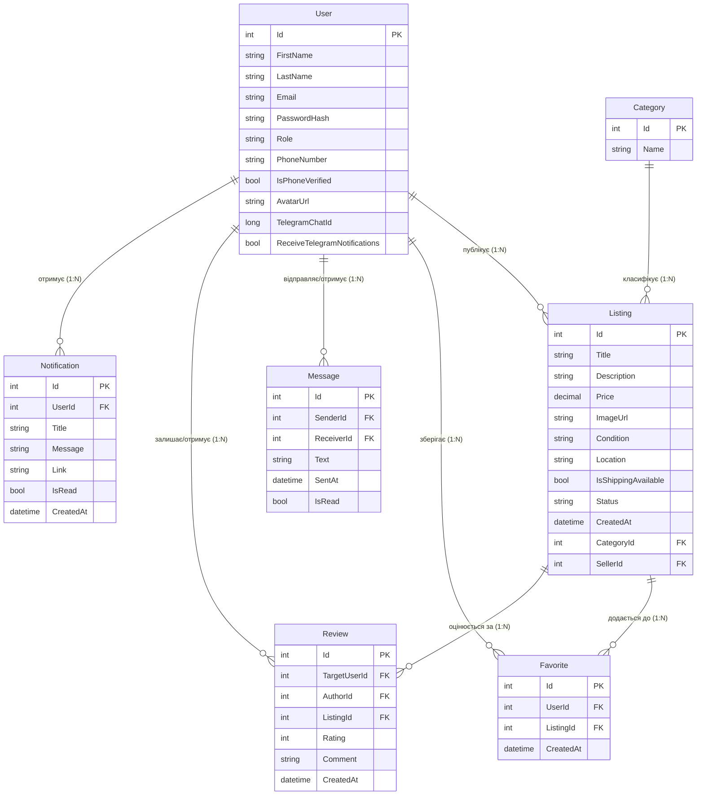

# Loop Market (TradeStorm.Api)

**Курс:** ОК20 «Розробка клієнт-серверних застосунків»  
**Заклад:** Кременчуцька гуманітарно-технологічна академія (КГТА)  
**Семестр:** 7 — монолітний застосунок  
**Тема:** 3.3. Платформа оголошень (marketplace)  
**Стек:** C# 10 / ASP.NET Core 10 / Entity Framework Core (SQLite) / SignalR / Scalar OpenAPI

---

## 🏛️ Архітектура застосунку (Багатошарова організація)

Застосунок реалізовано за строгою багатошаровою архітектурою з чітким розділом відповідальностей:
```
[Клієнт (SPA / Browser)]
       │
       ▼ (HTTP / WebSocket)
[API Controllers / SignalR Hubs]
       │
       ▼ (DTOs & ViewModels)
[Service Layer (Бізнес-логіка, валідація, права доступу)]
       │
       ▼ (Domain Entities)
[Repository Layer (Generic IRepository<T> & Спеціалізовані репозиторії)]
       │
       ▼ (LINQ / Eager Loading)
[Data Access (Entity Framework Core AppDbContext)]
       │
       ▼
[База Даних SQLite (loopmarket.db)]
```

### Структура шарів:
- **`Controllers/`**: Тонкі API-контролери, які приймають HTTP-запити, валідують DTO, витягують клейми поточного користувача (`ClaimsPrincipal`) та делегують роботу сервісам.
- **`Services/`**: Шар бізнес-логіки (`ListingService`, `FavoriteService`, `CategoryService`, `TelegramBotService`). Відповідає за перевірку бізнес-правил, перевірку належності ресурсу користувачу, зміну статусів.
- **`Repositories/`**: Шар доступу до даних (`IRepository<T>`, `ListingRepository`, `FavoriteRepository`). Ізолює специфіку EF Core, інкапсулює складні запити, фільтрацію, сортування та активне завантаження (eager loading `Include`).
- **`Data/`**: `AppDbContext`, конфігурація міграцій та індексів (`OnModelCreating`).
- **`Models/`**: Доменні сутності предметної області.
- **`DTOs/`**: Об'єкти передачі даних із вбудованими правилами валідації `DataAnnotations`.

---

## 📊 ER-діаграма предметної області (Entity-Relationship)



---

## 🚀 Як розгорнути та запустити проєкт «з нуля»

### Вимоги:
- .NET SDK 10.0+
- Клієнт Git

### Кроки запуску:
1. Клонувати репозиторій:
   ```bash
   git clone https://github.com/your-username/LoopMarket.git
   cd LoopMarket/TradeStorm.Api
   ```
2. Відновити залежності NuGet:
   ```bash
   dotnet restore
   ```
3. Застосувати міграції до бази даних SQLite:
   ```bash
   dotnet ef database update
   ```
4. Запустити веб-сервер:
   ```bash
   dotnet run
   ```
5. Відкрити у браузері:
   - **Головна сторінка каталогу:** `http://localhost:65083/index.html`
   - **Інтерактивна документація OpenAPI:** `http://localhost:65083/docs.html`
   - **Службовий endpoint перевірки стану (Health Check):** `http://localhost:65083/health`

---

## 📋 Виконання вимог етапів

### Етап 1: Ініціалізація проєкту та проєктування моделі даних (12 балів)
- [x] Репозиторій Git, чиста структура каталогів, налаштовано `.editorconfig` для єдиного стандарту форматування коду.
- [x] Стандартний службовий endpoint перевірки стану ASP.NET Core: `GET /health` із перевіркою працездатності БД SQLite (`DbHealthCheck`).
- [x] Спроєктовано повноцінну доменну модель предметної області (User, Listing, Category, Favorite, Review, Message, Notification), побудовано ER-діаграму.
- [x] Підключено SQLite через EF Core, налаштовано індекси, створено та застосовано міграції.
- [x] Реалізовано репозиторний (`IRepository<T>`, `ListingRepository`, `FavoriteRepository`) та сервісний шар (`ListingService`, `FavoriteService`, `CategoryService`) із суворим розподілом обов'язків.

### Етап 2: Операції CRUD, зв’язки між сутностями та обробка помилок (13 балів)
- [x] Реалізовано повний набір операцій CRUD для ключових ресурсів (Listings, Favorites, Categories, Users, Reviews).
- [x] Налаштовано зв'язки `1:N` між сутностями з каскадними правилами та поверненням вкладених об'єктів.
- [x] Усунено проблему **N+1** за допомогою активного завантаження (eager loading `Include()` та `ThenInclude()`).
- [x] Реалізовано гнучку серверну пагінацію (`page`, `pageSize`), фільтрацію за пошуковим словом, категорією, діапазоном цін, станом, статусом і сортування (`newest`, `price_asc`, `price_desc`).
- [x] Підключено стандартизоване подання помилок **RFC 7807 (ProblemDetails)** через `builder.Services.AddProblemDetails()`, `app.UseExceptionHandler()` та коректні HTTP-статуси (400, 401, 403, 404, 500).
