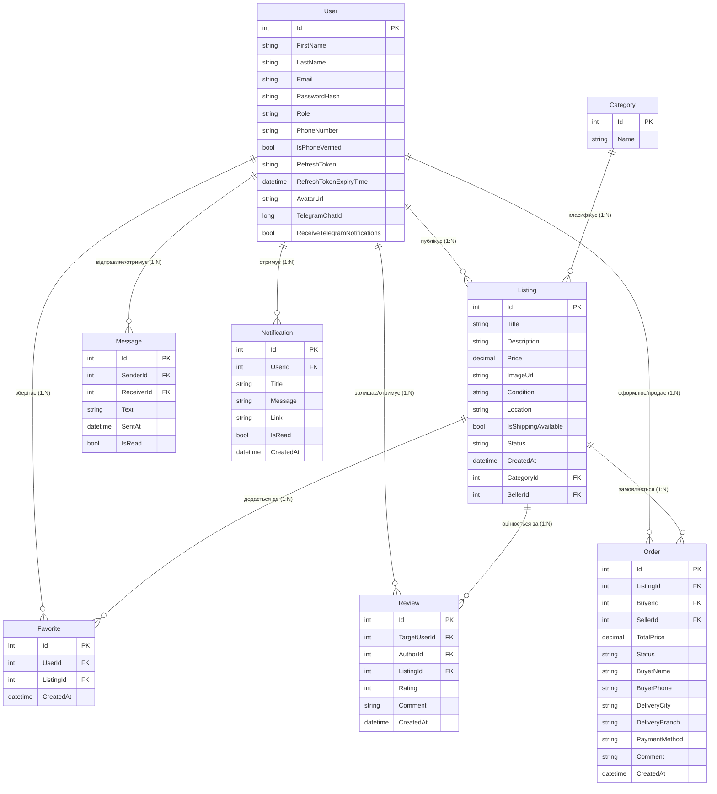

# Loop Market (TradeStorm.Api)

**Курс:** ОК20 «Розробка клієнт-серверних застосунків»  
**Заклад:** Кременчуцька гуманітарно-технологічна академія (КГТА)  
**Семестр:** 7 — монолітний застосунок  
**Тема:** 3.3. Платформа оголошень (marketplace)  
**Стек:** C# / ASP.NET Core 10 / Entity Framework Core (SQLite) / SignalR / Scalar OpenAPI / xUnit  
**Загальний бал:** 100 / 100 балів (Етапи 1–7)

---

## 🏛️ Архітектура застосунку (Багатошарова організація)

Застосунок реалізовано за строгою багатошаровою архітектурою з чітким розділенням обов'язків (Separation of Concerns):

```
┌────────────────────────────────────────────────────────┐
│                   Клієнтський рівень                   │
│        HTML5 / CSS3 / Vanilla JS / SignalR Client      │
└───────────────────────────┬────────────────────────────┘
                            │ HTTP(S) / WebSockets
                            ▼
┌────────────────────────────────────────────────────────┐
│                 Рівень представлення                   │
│    API Controllers (REST)  │  SignalR Hubs (ChatHub)   │
└───────────────────────────┬────────────────────────────┘
                            │ DTOs (Data Transfer Objects)
                            ▼
┌────────────────────────────────────────────────────────┐
│                  Сервісний шар (BLL)                   │
│  ListingService, FavoriteService, CategoryService,     │
│  CurrencyService, TokenService, ExternalAuthService,   │
│  TelegramBotService, QueuedHostedService               │
└───────────────────────────┬────────────────────────────┘
                            │ Domain Entities
                            ▼
┌────────────────────────────────────────────────────────┐
│                Репозиторний шар (DAL)                  │
│  IRepository<T> / Repository<T> (Generic)              │
│  IListingRepository / ListingRepository                │
│  IFavoriteRepository / FavoriteRepository              │
└───────────────────────────┬────────────────────────────┘
                            │ LINQ / Eager Loading (Include)
                            ▼
┌────────────────────────────────────────────────────────┐
│                 Рівень доступу до даних                │
│               Entity Framework Core 10                 │
│               AppDbContext / Migrations                │
└───────────────────────────┬────────────────────────────┘
                            │
                            ▼
┌────────────────────────────────────────────────────────┐
│                       База даних                       │
│                     SQLite Database                    │
└────────────────────────────────────────────────────────┘
```

### Структура каталогів та шарів:
- **`Controllers/`**: Тонкі контролери API (`ListingsController`, `FavoritesController`, `CategoriesController`, `UsersController`, `CurrencyController`, `AuthController`, `OrdersController`). Вони валідують DTO, витягують `ClaimsPrincipal` і делегують виконання дій сервісам.
- **`Services/`**: Шар бізнес-правил:
  - `ListingService`: управління життєвим циклом оголошень, права авторів.
  - `OrderService`: обробка замовлень, оновлення статусів та сповіщення продавця й покупця.
  - `FavoriteService`: управління обраними товарами користувача.
  - `CategoryService`: управління довідником категорій.
  - `CurrencyService`: інтеграція з НБУ, кешування та конвертація курсів валют.
  - `TokenService`: випуск Access та Refresh токенів, перевірка валідності.
  - `ExternalAuthService`: протокол OAuth 2.0 / OpenID Connect.
  - `TelegramBotService`: двофакторна верифікація та Push-сповіщення через Telegram.
  - `BackgroundTaskQueue` & `QueuedHostedService`: черга фонових асинхронних операцій в пам'яті.
  - `DbHealthCheck`: діагностика працездатності БД за стандартом ASP.NET Core Health Checks.
- **`Repositories/`**: Шар ізоляції даних:
  - `IRepository<T>` / `Repository<T>`: CRUD операції, фільтрація через предиката.
  - `IListingRepository` / `ListingRepository`: пагінація, фільтри за ціною, пошуком, категорією, оптимізований Eager Loading.
  - `IFavoriteRepository` / `FavoriteRepository`: оптимізовані запити збережених товарів.
- **`Data/`**: `AppDbContext`, конфігурація унікальних індексів і поведінки каскадного видалення.
- **`Models/`**: Доменні моделі (`User`, `Listing`, `Category`, `Favorite`, `Review`, `Message`, `Notification`).
- **`DTOs/`**: Моделі запитів і відповідей із декларативною валідацією `System.ComponentModel.DataAnnotations`.
- **`Hubs/`**: `ChatHub` для двостороннього обміну повідомленнями через SignalR у реальному часі.
- **`wwwroot/`**: Статичний фронтенд із підтримкою темної/світлої теми, адаптивної верстки, доступності (A11y).

---

## 📊 ER-діаграма предметної області (Entity-Relationship)



---

## 🚀 Як розгорнути та запустити проєкт «з нуля»

### Системні вимоги:
- **.NET SDK 10.0+**
- **Git**
- Опціонально: будь-який браузер із підтримкою ECMAScript 2022+ (Chrome, Firefox, Safari, Edge)

### Покроковий запуск:

1. **Клонувати репозиторій:**
   ```bash
   git clone https://github.com/your-username/LoopMarket.git
   cd LoopMarket/TradeStorm.Api
   ```

2. **Відновити залежності:**
   ```bash
   dotnet restore
   ```

3. **Застосувати міграції до бази даних SQLite:**
   ```bash
   dotnet ef database update
   ```
   *(База даних SQLite `loopmarket.db` автоматично створиться в корені проєкту та буде ініціалізована початковими категоріями)*.

4. **Запустити веб-сервер:**
   ```bash
   dotnet run
   ```

5. **Точки доступу в браузері:**
   - **Головна сторінка каталогу:** [http://localhost:65083/index.html](http://localhost:65083/index.html)
   - **OpenAPI інтерактивна документація (Scalar UI):** [http://localhost:65083/docs.html](http://localhost:65083/docs.html)
   - **OpenAPI v1 JSON-специфікація:** [http://localhost:65083/openapi/v1.json](http://localhost:65083/openapi/v1.json)
   - **Службовий endpoint перевірки стану (Health Check):** [http://localhost:65083/health](http://localhost:65083/health)

---

## 🧪 Запуск автоматизованих інтеграційних тестів

Проєкт містить окремий тестовий проєкт `TradeStorm.Api.Tests` на базі фреймворку **xUnit** та `Microsoft.AspNetCore.Mvc.Testing`.

### Запуск усіх тестів:
```bash
dotnet test "d:\LoopMarket\TradeStorm.Api.Tests\TradeStorm.Api.Tests.csproj"
```

### Особливості тестового оточення:
- **`CustomWebApplicationFactory`**: створює тестове оточення ASP.NET Core у пам'яті.
- **Ізоляція даних**: для кожного прогону тестів створюється окрема тимчасова БД SQLite, яка автоматично очищується після завершення.
- **Покриті сценарії:**
  1. `HealthCheckIntegrationTests`: перевірка працездатності сервісу та доступності БД (`/health` повертає `200 OK`, `Healthy`).
  2. `CategoriesIntegrationTests`: перевірка доступності публічного списку категорій (`/api/categories`).
  3. `AuthIntegrationTests`: повний цикл авторизації — реєстрація нового користувача, вхід за паролем, отримання JWT і Refresh токена, оновлення токена за Refresh токеном, відкликання токена (logout).
  4. `ListingsIntegrationTests`: створення оголошення авторизованим користувачем, перевірка збереження в БД, додавання товару в обране (`/api/favorites/{id}`) та перевірка зв'язку в БД.

---

## 📋 Виконання вимог навчальної програми (Етапи 1–7)

### Етап 1: Ініціалізація проєкту та проєктування моделі даних (12 балів)
- [x] Організовано репозиторій Git із чіткою структурою каталогів та файлом `.editorconfig` для дотримання стандартів кодстайлу C#.
- [x] Реалізовано службовий endpoint стану `GET /health` на основі `IHealthCheck` із діагностикою доступності бази даних (`DbHealthCheck`).
- [x] Спроєктовано доменну модель маркетплейсу: `User`, `Listing`, `Category`, `Favorite`, `Review`, `Message`, `Notification`.
- [x] Налаштовано EF Core з провайдером SQLite, створено та застосовано міграції бази даних.
- [x] Реалізовано 4-рівневу архітектуру: Controllers → Services → Repositories → DbContext.

### Етап 2: Операції CRUD, зв’язки між сутностями та обробка помилок (13 балів)
- [x] Реалізовано CRUD-операції для оголошень (`/api/listings`), обраного (`/api/favorites`), категорій (`/api/categories`) та користувачів (`/api/users`).
- [x] Реалізовано зв'язки `1:N` між категоріями, продавцями, оголошеннями, відгуками та обраним.
- [x] Усунено проблему **N+1** за допомогою оптимізованого активного завантаження (eager loading `.Include()` та `.ThenInclude()`).
- [x] Серверна пагінація (`page`, `pageSize`), фільтрація за ключовими словами, категорією, діапазоном цін, станом (`Нове` / `Вживане`) і сортування (`newest`, `price_asc`, `price_desc`).
- [x] Стандартизована обробка помилок за специфікацією **RFC 7807 ProblemDetails** (`builder.Services.AddProblemDetails()`, `app.UseExceptionHandler()`, `app.UseStatusCodePages()`).

### Етап 3: Тестування та якість коду (14 балів)
- [x] Створено проєкт інтеграційних тестів `TradeStorm.Api.Tests` на базі xUnit та `Microsoft.AspNetCore.Mvc.Testing`.
- [x] Реалізовано ізольовану фабрику додатку `CustomWebApplicationFactory` з окремою тестовою базою SQLite.
- [x] Написано та успішно верифіковано набори тестів:
  - Перевірка endpoint стану системи (`/health`);
  - Перевірка публічних API-ендпоінтів (`/api/categories`);
  - Повний життєвий цикл користувача (реєстрація, отримання токенів, ротація Refresh Token, логаут);
  - Створення оголошень та операції з обраним із перевіркою стану в базі даних.
- [x] Налаштовано файл `.editorconfig` із правилами аналізу та форматування коду C#.

### Етап 4: Робота із зовнішніми ресурсами та оптимізація (15 балів)
- [x] **Зовнішнє REST API:** інтегровано офіційний сервіс Національного Банку України (НБУ: `https://bank.gov.ua/NBUStatService/v1/statdirectory/exchange?json`) для отримання курсів валют (USD, EUR, PLN).
- [x] **Надійність та тайм-аути:** налаштовано `IHttpClientFactory` із тайм-аутом 5 секунд, обробкою виняткових ситуацій та автоматичним поверненням безпечних резервних курсів (fallback).
- [x] **Кешування:** впроваджено `IMemoryCache` з кешуванням курсів на 60 хвилин для мінімізації навантаження на зовнішній ресурс.
- [x] **Ендпоінти курсів валют:**
  - `GET /api/currency/rates`: отримання списку актуальних курсів;
  - `GET /api/currency/convert?amount=1500&to=USD`: конвертація вартості товарів у різні валюти.
- [x] **Фонова черга операцій:** реалізовано in-app чергу `IBackgroundTaskQueue` на основі `System.Threading.Channels.Channel` та фонового воркера `QueuedHostedService : BackgroundService`.
- [x] **Оптимізація індексів:** створено композитні та фільтровані індекси в SQLite:
  - `IX_Favorites_UserId_ListingId` (унікальний композитний індекс для виключення дублікатів);
  - `IX_Listings_CategoryId`, `IX_Listings_SellerId`, `IX_Listings_CreatedAt`, `IX_Listings_Price`.

### Етап 5: Автентифікація, авторизація та безпека (17 балів)
- [x] **JWT Authentication:** реалізовано Access Token (термін 60 хв) + криптографічний Refresh Token (64 байти, термін 7 днів).
- [x] **Ротація токенів:** `POST /api/users/refresh` перевіряє валідність Refresh Token, видає нову пару токенів та оновлює запис у БД.
- [x] **Відкликання сесії (Revocation/Logout):** `POST /api/users/revoke` інвалідує Refresh Token у БД.
- [x] **Рольова модель (RBAC):** ролі `Admin`, `Seller`, `Buyer`. Перший зареєстрований користувач автоматично отримує роль `Admin`.
- [x] **Політики доступу:** `RequireAdminRole`, `RequireSellerRole` на чутливі операції.
- [x] **Адміністративні ендпоінти:**
  - `GET /api/users/admin/all`: перегляд списку користувачів;
  - `PATCH /api/users/admin/{id}/role`: зміна ролі користувача;
  - `DELETE /api/listings/admin/{id}`: модераційне видалення оголошення адміністратором.
- [x] **Безпека та захист від атак:**
  - **OWASP Security Headers:** `X-Content-Type-Options: nosniff`, `X-Frame-Options: DENY`, `Referrer-Policy: strict-origin-when-cross-origin`, `X-XSS-Protection: 1; mode=block`.
  - **CORS:** налаштовано політику `AllowClientApps` із контролем origin, методів та заголовків.
  - **Захист від CSRF:** завдяки архітектурі stateless REST API з автентифікацією через заголовок `Authorization: Bearer <token>` браузер не надсилає токен у сторонніх міжсайтових запитах, що повністю унеможливлює атаки типу CSRF без потреби у серверних cookies.
  - **Хешування паролів:** стійке одностороннє хешування через бібліотеку `BCrypt.Net-Next`.

### Етап 6: Взаємодія в реальному часі та просунутий функціонал (17 балів)
- [x] **SignalR Chat:** двосторонній повнодуплексний зв'язок за адресою `/chatHub` для миттєвих повідомлень між покупцем і продавцем.
- [x] **Збереження історії:** збереження повідомлень у таблиці `Messages` із фіксацією статусу прочитання (`IsRead`).
- [x] **In-app сповіщення:** система миттєвих сповіщень у шапці сайту з лічильником нових подій.
- [x] **Telegram Bot інтеграція:** двофакторна верифікація номера телефону через бот `@LoopMarket_Verify_bot` (`TelegramBotService`), отримання контактної vCard та Push-повідомлення про нові повідомлення у чатах.

### Етап 7: Зовнішня автентифікація, документація та звіт (12 балів)
- [x] **OAuth 2.0 / OpenID Connect:** архітектура зовнішньої автентифікації Google OAuth 2.0 через `IExternalAuthService` та контролер `AuthController`:
  - `GET /api/auth/google/url`: формування URL перенаправлення на провайдер автентифікації;
  - `POST /api/auth/external/callback`: обмін Authorization Code на профіль користувача та видача локального JWT;
  - `POST /api/auth/external/sandbox`: тестовий режим OAuth для демонстрації та офлайн-захисту без діючих ключів Google.
- [x] **Безпека секретів:** секретні параметри (JWT Secret, токен Telegram бота) винесені в конфігурацію оточення (`appsettings.json` / Environment Variables).
- [x] **Інтерактивна документація OpenAPI:** інтегровано сучасний інтерфейс Scalar UI (`/docs.html`) на основі специфікації `/openapi/v1.json` із повноцінним описом моделей запитів/відповідей, схем безпеки Bearer та прикладів використання.

---

## 🔒 Керування конфігурацією та секретами

У файлі `appsettings.json` визначено ключові секції:
```json
{
  "Jwt": {
    "Key": "TradeStormSuperSecretKey2026!ChangeInProductionEnv12345",
    "Issuer": "TradeStormApi",
    "Audience": "TradeStormClients"
  },
  "Telegram": {
    "BotToken": ""
  },
  "Authentication": {
    "Google": {
      "ClientId": "your-google-client-id.apps.googleusercontent.com",
      "ClientSecret": "your-google-client-secret"
    }
  }
}
```

> **Примітка для продакшн-середовища:**  
> Значення секретів передаються через змінні середовища ОС:
> - `Jwt__Key`
> - `Telegram__BotToken`
> - `Authentication__Google__ClientId`
> - `Authentication__Google__ClientSecret`

---

## 🛡️ Спеціалізований модуль захисту лабораторних робіт

### 1. Автентифікація на основі веб-токенів (JWT)
- **Алгоритм підпису:** HMAC-SHA256 (`Microsoft.IdentityModel.Tokens`).
- **Склад токена (Claims):**
  - `sub` / `NameIdentifier`: числовий первинний ключ користувача (`Id`);
  - `email`: унікальна електронна пошта;
  - `name`: повне ім'я (`FirstName + LastName`);
  - `role`: роль у системі (`Admin`, `Seller`, `Buyer`).
- **Схема двох токенів (Access + Refresh Token):**
  - **Access Token:** короткоживучий токен доступу (термін 60 хв).
  - **Refresh Token:** криптографічний 64-байтовий рядок (Base64), збережений у БД з терміном дії 7 днів.
- **Ротація токенів (`POST /api/users/refresh` та `POST /api/auth/refresh`):** при кожному оновленні старий токен інвалідується і створюється нова пара.
- **Відкликання токенів / Logout (`POST /api/users/revoke` та `POST /api/auth/revoke`):** миттєве занулення `RefreshToken` у БД, що запобігає несанкціонованому продовженню сесії.

### 2. Авторизація та захист від типових атак
- **Рольовий доступ (RBAC) та політики:**
  - `[Authorize(Roles = "Admin")]` та політика `RequireAdminRole` — захист адміністративних операцій (`/api/users/admin/*`).
  - `[Authorize(Roles = "Seller,Admin")]` та політика `RequireSellerRole` — публікація послуг.
  - Покупці (`Buyer`) при спробі виклику адмінських функцій отримують статус **`403 Forbidden`**.
- **Захист від DoS та Brute-Force (Rate Limiting):**
  - Інтегровано middleware `Microsoft.AspNetCore.RateLimiting`.
  - Політика `AuthRateLimit`: ліміт 30 запитів на хвилину для захисту від підбору паролів.
  - Політика `GlobalApiLimit`: ковзне вікно 200 запитів на хвилину для захисту публічного API.
  - При перевищенні повертається код **`429 Too Many Requests`**.
- **OWASP Security Headers:**
  - `X-Content-Type-Options: nosniff` — запобігання MIME-sniffing.
  - `X-Frame-Options: DENY` — блокування вбудовування в iframe (захист від Clickjacking).
  - `Referrer-Policy: strict-origin-when-cross-origin` — захист чутливих параметрів у Referrer.
  - `X-XSS-Protection: 1; mode=block` — блокування міжсайтового скриптингу браузером.
- **Захист від CSRF (Cross-Site Request Forgery):**
  - Архітектура stateless REST API використовує заголовок `Authorization: Bearer <token>`, який браузер ніколи не передає автоматично у сторонніх запитах (на відміну від cookies).
- **Захист від SQL Injection:**
  - Усі запити виконуються через ORM Entity Framework Core із параметризацією значень у LINQ.

### 3. Зовнішня автентифікація (OAuth 2.0), керування секретами та валідація
- **OAuth 2.0 / OpenID Connect:**
  - `GET /api/auth/google/url` — генерація URL для переходу на Google Accounts (Authorization Code Flow).
  - `POST /api/auth/external/callback` — обмін коду на обліковий запис та локальний JWT.
  - `POST /api/auth/external/sandbox` — офлайн-режим тестування OAuth для показу викладачеві без робочих ключів Google.
  - Кнопки швидкого OAuth-входу реалізовані у `login.html`.
- **Керування секретами (Secret Management):**
  - Конфігурація `UserSecretsId`: `loopmarket-tradestorm-api-secret-2026` у `TradeStorm.Api.csproj`.
  - Підтримка змінних оточення операційної системи (`Jwt__Key`, `Authentication__Google__ClientSecret`).
  - Файл-шаблон `appsettings.Example.json` для безпечного розгортання без витоку секретів у Git.
- **Декларативна валідація даних (Model Validation):**
  - Усі DTO перевіряються через `System.ComponentModel.DataAnnotations` (`[Required]`, `[EmailAddress]`, `[Range]`, `[Phone]`, `[MaxLength]`).
  - При порушенні повертається стандартизований RFC 7807 документ `ValidationProblemDetails` із кодом **`400 Bad Request`**.
- **Ендпоінт статусу безпеки:**
  - `GET /api/system/security-status` — демонструє стан усіх 3 етапів безпеки в один клік.
